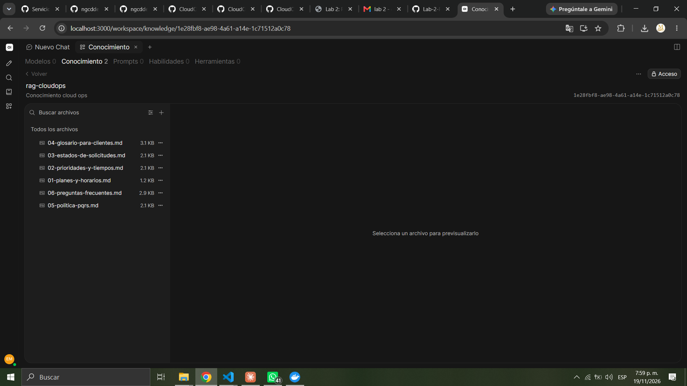
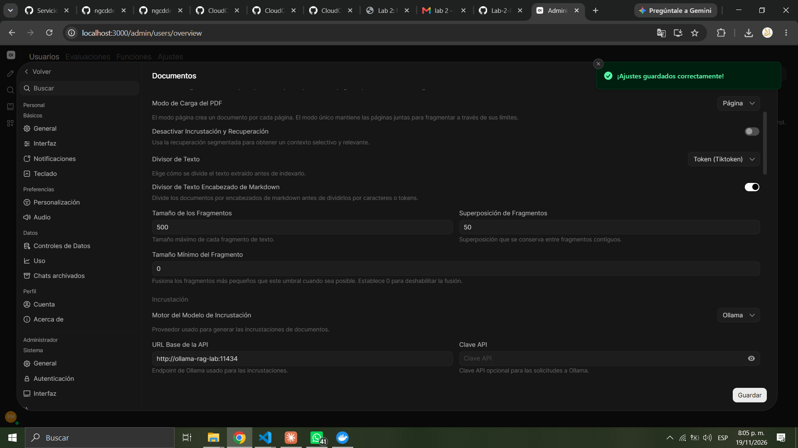
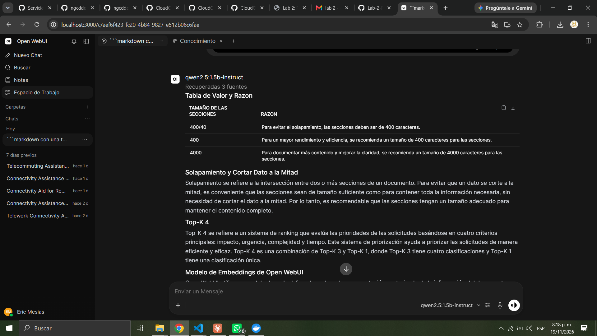

# E.1 Base de conocimiento y estrategia de corte

## Contenido de la base

Se prepararon seis documentos Markdown en español y dirigidos a los clientes de Forja Digital:

1. `01-planes-y-horarios.md`: disponibilidad mensual y horarios de los planes.
2. `02-prioridades-y-tiempos.md`: significado de P1–P4 y tiempos de respuesta y solución.
3. `03-estados-de-solicitudes.md`: estados de solicitudes, incidentes, cambios y sitios.
4. `04-glosario-para-clientes.md`: explicación de avisos del portal en lenguaje de cliente.
5. `05-politica-pqrs.md`: tipos de PQRS y orientación para su seguimiento.
6. `06-preguntas-frecuentes.md`: 20 preguntas frecuentes con sus respuestas.

El contenido se elaboró a partir de los documentos del proyecto sobre planes, prioridades, glosario y proceso de atención. Los canales y plazos de PQRS que no constan en esas fuentes están identificados como `[PROPUESTA]`; deben revisarse antes de comunicarlos como política vigente.

## Carga en Open WebUI

La captura confirma que los seis archivos aparecen cargados en una base de conocimiento de Open WebUI. El nombre que se ve es `rag-cloudops`, en lugar del nombre sugerido en la guía (`base-soporte-forja`). La captura no muestra claramente la configuración de visibilidad, por lo que este informe no afirma que la base esté configurada como pública.

## Configuración de fragmentación

La captura de ajustes muestra el divisor de texto `Token (Tiktoken)`, un tamaño de fragmento de 500 y una superposición de 50. También se ve activado el divisor por encabezados Markdown. La pantalla muestra el proveedor de incrustaciones Ollama y la dirección base `http://ollama-rag-lab:11434`; no se alcanza a identificar el nombre del modelo de incrustaciones ni se ve el ajuste Top K.

El tamaño de 500 tokens busca conservar suficiente contexto para explicar cada tema sin formar fragmentos demasiado extensos. La superposición de 50 tokens conserva parte del contexto entre fragmentos contiguos para reducir el riesgo de separar una explicación o dato relacionado. Separar por encabezados Markdown ayuda a respetar los temas definidos en cada documento. La guía indica volver a cargar los documentos después de cambiar estos ajustes; las capturas disponibles no permiten confirmar si esa recarga se realizó.

## Observación de una respuesta de prueba

En la captura de una conversación de prueba, Open WebUI indica que recuperó tres fuentes. Sin embargo, la respuesta describe Top-K como si fuera una matriz de prioridades basada en impacto, urgencia, complejidad y tiempo. Esa explicación no corresponde a la configuración de recuperación indicada para la actividad: Top K establece cuántos fragmentos se recuperan para responder. Por tanto, la captura sirve para documentar una prueba y detectar una respuesta incorrecta, no para demostrar que la respuesta del asistente fue correcta. Se requiere corregir el comportamiento del modelo y repetir la prueba con preguntas y respuestas esperadas antes de considerar validada la calidad del RAG.

## Pendientes de validación

- Confirmar si la base debe renombrarse `base-soporte-forja` y verificar su visibilidad.
- Confirmar el valor Top K en la configuración de recuperación; no queda visible en la captura de ajustes.
- Registrar el nombre exacto del modelo de incrustaciones de Ollama.
- Confirmar que los seis documentos se volvieron a cargar después de guardar los ajustes de fragmentación.
- Revisar y aprobar las propuestas de canales y plazos de PQRS.
- Corregir la respuesta errónea observada y ejecutar pruebas de recuperación con resultados esperados antes de reportar eficacia.
